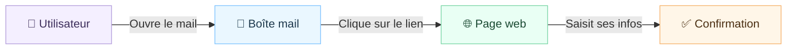
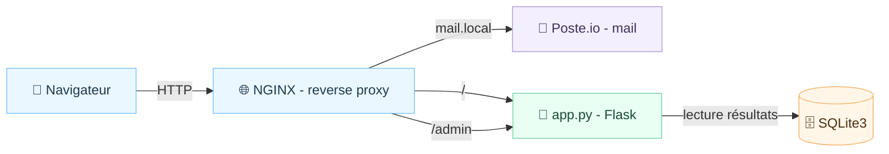

# 🌟 Plateforme locale « Mise à jour de sécurité »

## 1) Contexte du projet

Plateforme **100% locale** pour présenter un parcours complet de mise à jour de sécurité, sans dépendance Internet. L’objectif est de montrer le cheminement utilisateur, puis d’exposer clairement les blocs techniques (mail, reverse proxy, app, base de données). Le tout est orchestré par **Docker Compose**.

| 🔎 Navigation rapide | 🔗 Lien |
| --- | --- |
| 🧭 Portail utilisateur | http://portal-legacy.example.com |
| 🔐 Accès admin (résultats) | http://portal-legacy.example.com/admin |
| 📮 Webmail Poste.io | http://mail.local:8080 |
| 🛠️ Admin Poste.io | http://mail.local:8080/admin |

> ⚠️ Pré-requis local unique : ajouter `portal-legacy.example.com` et `mail.local` dans `/etc/hosts`.

---

## 2) Déroulé de la présentation (vision simple)

**Objectif :** expliquer le parcours sans technique, pour tout le monde. 🎯

**Ce que l’on montre :**
- 👤 L’utilisateur suit un parcours guidé.
- 📮 Le mail déclenche l’action.
- 🌐 Le portail centralise l’expérience.
- ✅ Une confirmation clôt le parcours.

---

## 3) Détails techniques (bloc par bloc)

### Vue d’ensemble technique

### Blocs techniques

| 🧱 Bloc | ✅ Rôle essentiel | 📌 Fichiers / endpoints clés |
| --- | --- | --- |
| 📮 Poste.io | Webmail local complet (lecture/envoi) | `email/security_update_email.html`, `mail.local:8080` |
| 🌐 NGINX | Point d’entrée unique + routage | `nginx/site.conf` |
| 🧩 Web (Flask) | Portail + admin + API locale | `app/app.py`, `app/templates/*` |
| 🗄️ SQLite3 | Stockage local des résultats démo | `app/app.py` (DB sqlite) |

### 🚀 Lancement & accès (optimisé par techno)

> Tous les services sont **100% locaux**. Aucune dépendance Internet.

| 🔧 Techno | ✅ Action essentielle | 💻 Commande / Accès | 🔗 Détails utiles |
| --- | --- | --- | --- |
| 🧭 Hôtes locaux | Déclarer les domaines locaux | `sudo sh -c 'printf "127.0.0.1 portal-legacy.example.com\n127.0.0.1 mail.local\n" >> /etc/hosts'` | Prérequis unique |
| 🐳 Docker Compose | Démarrer la stack principale | `docker compose up -d --build` | — |
| 📮 Poste.io | Démarrer la stack mail | `docker-compose -f docker-compose-posteio.yml up -d --build` | Webmail: http://mail.local:8080 |
| 🧩 Application web | Accéder au portail | http://portal-legacy.example.com | Admin résultats: http://portal-legacy.example.com/admin |
| 📮 Poste.io (ports) | Accéder aux ports exposés | HTTP: http://mail.local:8080 | HTTPS: https://mail.local:8443 |
