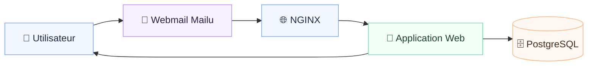
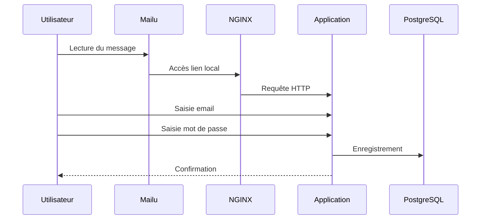

# 🧰 Plateforme locale — Mise à jour de sécurité (Infrastructure Docker)

## 🎯 Objectif du projet
Mettre en place une **plateforme locale complète**, entièrement **hors ligne**, permettant :
- d’analyser un **parcours utilisateur email ➜ portail local**,
- de comprendre **l’architecture technique**, les flux et les interactions entre services,
- de disposer d’un **support clair et professionnel** pour une présentation managériale.

---

## 🧭 Principes clés
- 📴 Fonctionnement **100 % hors ligne**
- 🐳 Orchestration via **Docker Compose**
- 🌐 **NGINX** comme serveur web et reverse proxy
- ✉️ **Mailu** pour la chaîne mail (UI + SMTP/IMAP)
- 🗄️ **PostgreSQL** pour la persistance applicative
- 🎨 Interfaces sobres (blanc / gris)

---

## 🧱 Architecture globale



---

## 🔁 Parcours utilisateur



---

## 🧩 Conteneurs

| Conteneur | Rôle |
|---------|------|
| mailu | Chaîne mail |
| nginx | Web |
| app | Applicatif |
| postgres | Base de données |

---

## 🖥️ Portail
- Design blanc / gris
- Champs email + mot de passe (masquable)
- Bouton connexion avec chargement
- Message de confirmation
- Retour à l’accueil

---

## 🚀 Démarrage

```bash
docker compose up -d
```

---

## 📜 Licence
Apache License 2.0
