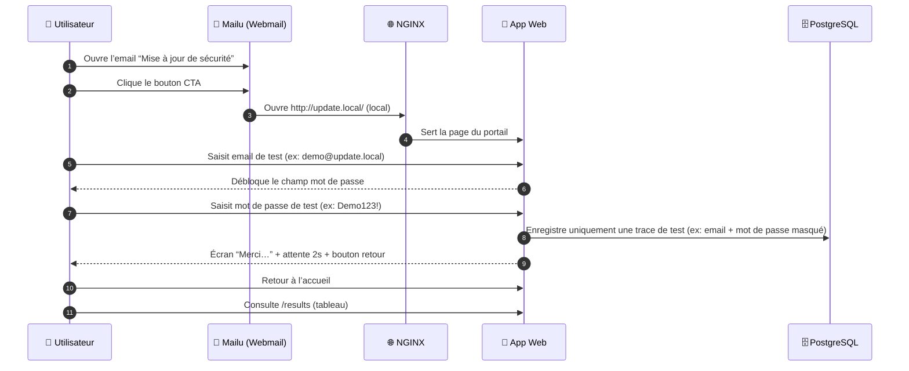

# 🧰 Atelier “Mise à jour de sécurité” — Plateforme hors‑ligne (Docker)

> Objectif : mettre en place une **plateforme d’observation** 100% **hors‑ligne** pour analyser un parcours “email ➜ portail local”,
> comprendre les composants (mail, web, app, base) et présenter l’infrastructure à un supérieur.
>
> ✅ **Aucune donnée réelle** ne doit être saisie.  
> ✅ Les champs “email / mot de passe” sont **strictement de test** (valeurs de démonstration uniquement) et **les saisies non‑autorisées sont refusées**.  
> 🔒 La plateforme est isolée, sans accès Internet.

---

## 🧭 Principes
- 📴 **Zéro Internet** (réseau Docker interne + pas de dépendance externe)
- 🐳 **Tout sous Docker Compose**
- 🌐 **NGINX** comme serveur web / reverse proxy
- ✉️ **Mailu** pour l’interface webmail + la chaîne SMTP/IMAP (Postfix en back)
- 🗄️ **PostgreSQL** comme base (robuste, standard, simple à auditer)
- 🧾 Journalisation **pédagogique** : **uniquement des données de test**, et **redaction** (masquage) côté stockage/affichage

---

## 🧱 Architecture (format paysage)

```mermaid
flowchart LR
  classDef pastel fill:#F2F7FF,stroke:#7AA2F7,color:#1F2A44;
  classDef pastel2 fill:#F7F2FF,stroke:#B38BFF,color:#2A1F44;
  classDef pastel3 fill:#F2FFF7,stroke:#77D9A8,color:#1F442A;
  classDef pastel4 fill:#FFF7F2,stroke:#FFB37A,color:#442A1F;

  U([👤 Utilisateur]):::pastel
  M[📮 Webmail Mailu<br/>UI + IMAP/SMTP]:::pastel2
  N[🌐 NGINX<br/>Reverse Proxy]:::pastel
  A[🧩 App Web<br/>Portail local]:::pastel3
  D[(🗄️ PostgreSQL<br/>Données de test)]:::pastel4

  U -->|Ouvre l'email| M
  M -->|Clique le bouton “Accepter la mise à jour”| N
  N -->|/ -> app| A
  A -->|écrit (test) + redaction| D
  A -->|/results| U
```

---

## 🧾 Matrice de flux (format portrait)



---

## 🧩 Conteneurs & services (Docker)

| Conteneur | Rôle | Ports (ex) | Remarques |
|---|---|---:|---|
| `mailu-front` | Webmail + UI | `8025:80` | Interface web |
| `mailu-smtp` | Chaîne SMTP (Postfix) | `1025:25` | Envoi local (lab) |
| `nginx` | Reverse proxy | `8080:80` | `update.local` |
| `app` | Portail local | interne | UI + API minimale |
| `db` | PostgreSQL | `5432:5432` | réseau interne seulement (idéalement) |

> Les noms exacts dépendront de la génération Mailu (compose) — l’objectif est de documenter **les rôles**.

---

## 🎨 Spécifications UI (portail local)
- Thème **blanc / gris**, carte avec **angles arrondis** + ombre légère
- Champs :
  1) **Email** (validation) → **débloque** le champ mot de passe
  2) **Mot de passe** (bouton 👁️ afficher/masquer)
- Bouton **Se connecter** → animation de chargement
- Après “connexion” (test) :
  - grand cadre **rouge** (ombre + arrondis)
  - message : **« Merci, votre demande a bien été enregistrée »**
  - attente **2 secondes**
  - bouton **Revenir à l’accueil** (retour login)

### ✅ Garde‑fous
- Le portail n’accepte que des **valeurs de test** (ex : `demo@update.local` + `Demo123!`).
- Toute autre valeur est **refusée** avec un message : “Saisie non autorisée (test uniquement)”.

---

## 📧 Email (gabarit)
- Couleurs : **blanc / gris / violet**
- Bouton CTA : **Accepter la mise à jour**
- Lien local : `http://update.local/` (via NGINX)

⚠️ Note : ne pas reprendre logos/visuels propriétaires. Utiliser un entête générique “Support IT (Lab)”.

---

## 🗄️ Données stockées (test uniquement)
**Choix recommandé :** stocker **email** + **mot de passe masqué** (ex : `D•••••!`) ou **hash** + suffixe, jamais des secrets réels.

Table `lab_submissions` :
- `id` (PK)
- `email_test` (TEXT)
- `password_masked` (TEXT) *(ou `password_hash`)*
- `created_at` (TIMESTAMP)

Page `/results` :
- tableau listant `email_test`, `password_masked`, `created_at`

---

## 🚀 Démarrage rapide (hors‑ligne)

1) Ajouter au `hosts` local (machine hôte) :
```
127.0.0.1 update.local
127.0.0.1 mail.local
```

2) Démarrer :
```bash
docker compose up -d
```

3) Accès :
- Webmail : `http://mail.local:8025`
- Portail : `http://update.local:8080`
- Résultats : `http://update.local:8080/results`

---

## 🧪 Démonstration (checklist)
- ✅ Montrer le réseau Docker isolé
- ✅ Montrer l’email “Mise à jour de sécurité” dans Mailu
- ✅ Cliquer le CTA ➜ ouverture du portail local (NGINX)
- ✅ Saisie des **valeurs de test** ➜ confirmation ➜ retour
- ✅ Ouvrir `/results` ➜ vérifier l’enregistrement (masqué)

---

## ⚠️ Disclaimer
Plateforme d’analyse **hors‑ligne**. Usage interne.  
Ne jamais utiliser avec des données réelles. Ne jamais déployer sur Internet.

---

## 📜 Licence
Apache License 2.0
