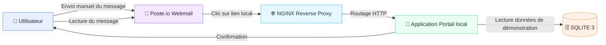
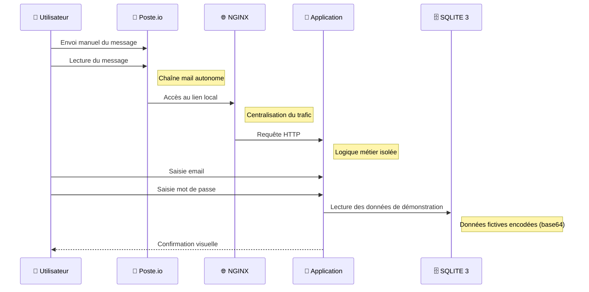

# 🎯 Plateforme locale "Mise à jour de sécurité"

Ce dépôt déploie une plateforme locale (100% hors ligne) pour démontrer les flux d'une mise à jour de sécurité.
L'ensemble est orchestré avec Docker Compose et repose sur : NGINX, Poste.io, une application web et SQLITE3.


## 🧱 Architecture globale




## 🔁 Flux applicatif




## 🖥️ Portail applicatif

- 🎨 Blanc / gris
- 🧱 Cartes arrondies
- 👁️ Mot de passe masquable
- ⏳ Animation de chargement
- 🔴 Écran de confirmation
- 🔐 Accès admin séparé pour les données de démonstration


## 🔐 Accès GUI BDD

- Identifiant : `alix`
- Mot de passe : `***REDACTED***`


## 🗂️ Arborescence du projet

```
.
├── app
│   ├── Dockerfile
│   ├── app.py
│   ├── requirements.txt
│   ├── static
│   │   ├── app.js
│   │   └── styles.css
│   └── templates
│       ├── index.html
│       └── results.html
├── db
│   └── init.sql
├── email
│   └── security_update_email.html
├── docker-compose.yml
├── menu
│   └── menu.sh
├── nginx
│   └── site.conf
└── README.md
```


### 🧱 Stack principale (NGINX + app + PostgreSQL + menu)

1. Accéder aux interfaces :

| Usage | Lien |
|---|---|
| Portail applicatif | (https://portal-legacy.example.com/) |
| Auth Panel - BDD | (https://portal-legacy.example.com/admin) |
| Identifiants - GUI BDD | (https://portal-legacy.example.com/results) |

### ✉️ Poste.io (webmail)

1. Accéder aux interfaces :

| Usage | Lien |
|---|---|
| Webmail | https://mail.local:8443 |
| Admin | https://mail.local:8443/admin/login |


## 🧰 Dépannage rapide

```bash
docker-compose down -v --remove-orphans
```


## 📴 Notes hors ligne

- Aucun service n'effectue d'accès sortant.
- Les images Docker doivent être disponibles localement pour respecter un environnement entièrement déconnecté.


## 🚀 Démarrage de l'infra

1. Ajouter les hôtes locaux (si nécessaire) :

```bash
sudo sh -c 'printf "127.0.0.1 portal-legacy.example.com\n127.0.0.1 mail.local\n" >> /etc/hosts'
```

2. Démarrer la plateforme :

```bash
docker-compose up -d --build && docker-compose -f docker-compose.yml up -d --build
```
