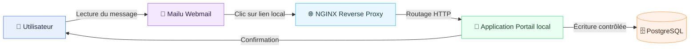
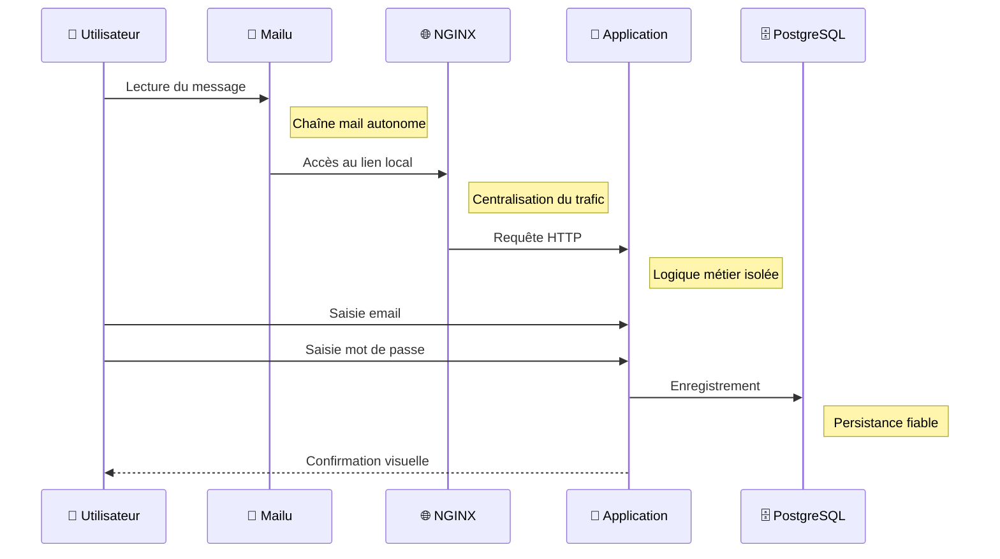

# Plateforme locale "Mise à jour de sécurité"

Ce dépôt déploie une plateforme locale (100% hors ligne) pour démontrer les flux d'une mise à jour de sécurité.
L'ensemble est orchestré avec Docker Compose et repose sur : NGINX, Mailu, une application web et PostgreSQL.

## 🎯 Objectif

Construire une **plateforme locale complète**, entièrement **hors ligne**, afin de :
- comprendre le **fonctionnement réel d’une chaîne applicative moderne**,
- visualiser clairement les **flux entre services**,
- présenter une **architecture propre, lisible et professionnelle**.

## 🧭 Principes fondamentaux


## 🎯 Objectif

Construire une **plateforme locale complète**, entièrement **hors ligne**, afin de :
- comprendre le **fonctionnement réel d’une chaîne applicative moderne**,
- visualiser clairement les **flux entre services**,
- présenter une **architecture propre, lisible et professionnelle**.


## 🧭 Principes fondamentaux

- 📴 **Aucune dépendance Internet**
- 🐳 **Tout est conteneurisé** (Docker Compose)
- 🌐 **NGINX** comme point d’entrée unique
- ✉️ **Mailu** pour la chaîne mail complète
- 🗄️ **PostgreSQL** pour la persistance
- 🎨 Interfaces sobres et cohérentes


## 🧱 Architecture globale (vue paysage)




## 🔁 Flux applicatif & bénéfices (vue paysage)



### 💡 Lecture simple du flux

- 👤 **Utilisateur** : suit un parcours clair et guidé.
- 📮 **Mailu** : démontre la réception et lecture d’un message.
- 🌐 **NGINX** : point de passage unique et optimisé.
- 🧩 **Application** : cœur fonctionnel.
- 🗄️ **PostgreSQL** : mémoire du système.

## 🧩 Conteneurs & responsabilités

| Service | Rôle | Bénéfice |
|-------|------|----------|
| 📮 Mailu | Webmail + SMTP | Autonomie |
| 🌐 NGINX | Reverse proxy | Performance |
| 🧩 Application | Logique | Maîtrise |
| 🗄️ PostgreSQL | Données | Fiabilité |

## 🖥️ Portail applicatif

- 🎨 Blanc / gris
- 🧱 Cartes arrondies
- 👁️ Mot de passe masquable
- ⏳ Animation de chargement
- 🔴 Écran de confirmation

## 🗂️ Arborescence


### 💡 Lecture simple du flux

- 👤 **Utilisateur** : suit un parcours clair et guidé.
- 📮 **Mailu** : démontre la réception et lecture d’un message.
- 🌐 **NGINX** : point de passage unique et optimisé.
- 🧩 **Application** : cœur fonctionnel.
- 🗄️ **PostgreSQL** : mémoire du système.


## 🧩 Conteneurs & responsabilités

| Service | Rôle | Bénéfice |
|-------|------|----------|
| 📮 Mailu | Webmail + SMTP | Autonomie |
| 🌐 NGINX | Reverse proxy | Performance |
| 🧩 Application | Logique | Maîtrise |
| 🗄️ PostgreSQL | Données | Fiabilité |


## 🖥️ Portail applicatif

- 🎨 Blanc / gris
- 🧱 Cartes arrondies
- 👁️ Mot de passe masquable
- ⏳ Animation de chargement
- 🔴 Écran de confirmation


## 🗂️ Arborescence

```
.
├── app
│   ├── Dockerfile
│   ├── app.py
│   ├── requirements.txt
│   ├── static
│   │   ├── app.js
│   │   └── styles.css
│   └── templates
│       ├── index.html
│       └── results.html
├── db
│   └── init.sql
├── email
│   └── security_update_email.html
├── mailu
│   └── mailu.env
├── menu
│   └── menu.sh
├── nginx
│   └── site.conf
├── docker-compose.yml
└── README.md
```


## 🚀 Lancement (étapes détaillées)

> Tous les services sont **100% locaux**. Aucune dépendance Internet.

| Étape | Status | Description essentielle | Commande/Action | Liens utiles |
|---|---|---|---|---|
| 1 | 🟦 Pré-requis | Ajouter l’hôte local `portal-legacy.example.com` | `sudo sh -c 'echo "127.0.0.1 portal-legacy.example.com" >> /etc/hosts'` | — |
| 2 | 🟩 Démarrage | Lancer la stack Docker Compose | `docker compose up --build` | — |
| 3 | 🟨 Menu | Lire les accès affichés par le service `menu` | Automatique (terminal) | — |
| 4 | 🟪 Portail | Accéder au portail applicatif | Navigateur | http://portal-legacy.example.com |
| 5 | 🟥 Résultats | Consulter les soumissions enregistrées | Navigateur | http://portal-legacy.example.com/results |
| 6 | 🟫 Webmail | Ouvrir l’interface Mailu | Navigateur | http://webmailu:8081 |
| 7 | ⬛ Admin | Accès administration Mailu | Navigateur | http://webmailu:8081/admin |

## ✅ Vérification rapide

- Portail applicatif : `http://portal-legacy.example.com`
- Résultats : `http://portal-legacy.example.com/results`
- Webmail Mailu : `http://webmailu:8081`
- Admin Mailu : `http://webmailu:8081/admin`

## ✉️ Email HTML

Le template HTML de l'email "Mise à jour de sécurité" est disponible dans :
`email/security_update_email.html`.

## 📴 Notes hors ligne

- Aucun service n'effectue d'accès sortant.
- Les images Docker doivent être disponibles localement pour respecter un environnement entièrement déconnecté.

## 📌 Valeur ajoutée

- 🔍 Lecture claire des flux
- 🧠 Compréhension infra/app
- 📦 Base extensible
- 🗣️ Support de présentation

## ✅ Vérification rapide

- Portail applicatif : `http://portal-legacy.example.com`
- Résultats : `http://portal-legacy.example.com/results`
- Webmail Mailu : `http://webmailu:8081`
- Admin Mailu : `http://webmailu:8081/admin`


## ✉️ Email HTML

Le template HTML de l'email "Mise à jour de sécurité" est disponible dans :
`email/security_update_email.html`.


## 📴 Notes hors ligne

- Aucun service n'effectue d'accès sortant.
- Les images Docker doivent être disponibles localement pour respecter un environnement entièrement déconnecté.


## 📌 Valeur ajoutée

- 🔍 Lecture claire des flux
- 🧠 Compréhension infra/app
- 📦 Base extensible
- 🗣️ Support de présentation


## 📜 Licence

Apache License 2.0


## Lancement

1. Ajouter l'hôte local (si nécessaire) :

```bash
sudo sh -c 'echo "127.0.0.1 portal-legacy.example.com" >> /etc/hosts'
```

2. Démarrer la plateforme :

```bash
docker compose up --build
```

Le service `menu` affiche directement les liens utiles dans le terminal.


## Notes hors ligne

- Aucun service n'effectue d'accès sortant.
- Les images Docker doivent être disponibles localement pour respecter un environnement entièrement déconnecté.
