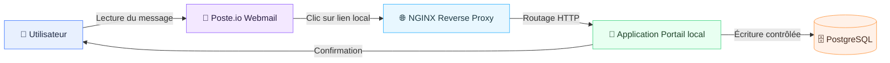

# Plateforme locale "Mise à jour de sécurité"

Ce dépôt déploie une plateforme locale (100% hors ligne) pour démontrer les flux d'une mise à jour de sécurité.
L'ensemble est orchestré avec Docker Compose et repose sur : NGINX, Poste.io, une application web et PostgreSQL.


## 🎯 Objectif

Construire une **plateforme locale complète**, entièrement **hors ligne**, afin de :
- comprendre le **fonctionnement réel d’une chaîne applicative moderne**,
- visualiser clairement les **flux entre services**,
- présenter une **architecture propre, lisible et professionnelle**.


## 🧭 Principes fondamentaux

- 📴 **Aucune dépendance Internet**
- 🐳 **Tout est conteneurisé** (Docker Compose)
- 🌐 **NGINX** comme point d’entrée unique
- ✉️ **Poste.io** pour la chaîne mail complète
- 🗄️ **PostgreSQL** pour la persistance
- 🎨 Interfaces sobres et cohérentes


## 🧱 Architecture globale (vue paysage)




## 🔁 Flux applicatif & bénéfices (vue paysage)


### 💡 Lecture simple du flux

- 👤 **Utilisateur** : suit un parcours clair et guidé.
- 📮 **Poste.io** : démontre la réception et lecture d’un message.
- 🌐 **NGINX** : point de passage unique et optimisé.
- 🧩 **Application** : cœur fonctionnel.
- 🗄️ **PostgreSQL** : mémoire du système.


## 🧩 Conteneurs & responsabilités

| Service | Rôle | Bénéfice |
|-------|------|----------|
| 📮 Poste.io | Webmail + SMTP | Autonomie |
| 🌐 NGINX | Reverse proxy | Performance |
| 🧩 Application | Logique | Maîtrise |
| 🗄️ PostgreSQL | Données | Fiabilité |


## 🖥️ Portail applicatif

- 🎨 Blanc / gris
- 🧱 Cartes arrondies
- 👁️ Mot de passe masquable
- ⏳ Animation de chargement
- 🔴 Écran de confirmation


## 🗂️ Arborescence

```
.
├── app
│   ├── Dockerfile
│   ├── app.py
│   ├── requirements.txt
│   ├── static
│   │   ├── app.js
│   │   └── styles.css
│   └── templates
│       ├── index.html
│       └── results.html
├── db
│   └── init.sql
├── email
│   └── security_update_email.html
├── docker-compose.yml
├── menu
│   └── menu.sh
├── nginx
│   └── site.conf
└── README.md
```


## 🚀 Lancement (étapes détaillées)

> Tous les services sont **100% locaux**. Aucune dépendance Internet.

| Étape | Status | Description essentielle | Commande/Action | Liens utiles |
|---|---|---|---|---|
| 1 | 🟦 Pré-requis | Ajouter les hôtes locaux `portal-legacy.example.com` et `mail.local` | `sudo sh -c 'printf "127.0.0.1 portal-legacy.example.com\n127.0.0.1 mail.local\n" >> /etc/hosts'` | — |
| 2 | 🟩 Démarrage | Lancer la stack Docker Compose | `docker compose up -d --build` | — |
| 2 | 🟩 Démarrage | Lancer la stack Docker Compose (poste.io) | `docker-compose -f docker-compose-posteio.yml up -d --build` | — |
| 2 | 🟩 Démarrage | Lancer la stack Docker Compose (v2) | `docker compose up -d --build` | — |
| 3 | 🟨 Menu | Lire les accès affichés par le service `menu` | Automatique (terminal) | — |
| 4 | 🟪 Portail | Accéder au portail applicatif | Navigateur | http://portal-legacy.example.com |
| 5 | 🟥 Résultats | Consulter les soumissions enregistrées | Navigateur | http://portal-legacy.example.com/results |
| 6 | 🟫 Webmail | Ouvrir l’interface Poste.io | Navigateur | http://mail.local:8080 |
| 7 | ⬛ Admin | Accès administration Poste.io | Navigateur | http://mail.local:8080/admin |


## ✅ Vérification rapide

- Portail applicatif : `http://portal-legacy.example.com`
- Résultats : `http://portal-legacy.example.com/results`
- Webmail Poste.io : `http://mail.local:8080`
- Admin Poste.io : `http://mail.local:8080/admin`

## ✉️ Poste.io (ports exposés)

- HTTP (webmail/admin) : `http://mail.local:8080` → conteneur 80
- HTTPS : `https://mail.local:8443` → conteneur 443
- SMTP : `25` / `465` / `587`
- IMAP : `143` / `993`
- POP3 : `110` / `995`
- Sieve : `4190`


## ✉️ Email HTML

Le template HTML de l'email "Mise à jour de sécurité" est disponible dans :
`email/security_update_email.html`.

## 📤 Envoi automatique via SMTP Poste.io

Un script prêt à l'emploi est fourni pour envoyer l'email HTML via le SMTP local de Poste.io :

```bash
SMTP_HOST=localhost \
SMTP_PORT=25 \
SMTP_FROM="C'CCIN <admin@mail.local>" \
SMTP_TO="destinataire@mail.local" \
python3 email/send_security_update.py
```

- Le template est chargé par défaut depuis `email/security_update_email.html`.
- Utilisez `--no-tls` si votre configuration SMTP n'utilise pas STARTTLS.
- Pour l'authentification, ajoutez `SMTP_USER`/`SMTP_PASSWORD`.
- Pour SMTP SSL (port 465), ajoutez `SMTP_USE_SSL=true`.

## 🔔 Notification locale (nouvel email)

Un script de surveillance IMAP notifie votre poste via `notify-send` lorsqu'un mail arrive :

```bash
IMAP_HOST=mail.local \
IMAP_PORT=993 \
IMAP_USE_SSL=true \
IMAP_USER=admin@mail.local \
IMAP_PASSWORD=VOTRE_MDP \
python3 email/notify_new_mail.py
```

Pour lancer automatiquement la surveillance au login (systemd utilisateur) :

```bash
email/install_notifications.sh
```

> Le service utilise `notify-send` (libnotify). Si indisponible, un message est affiché dans le terminal.

### 🧪 Diagnostic rapide si aucun mail ne sort/revient

1. Vérifiez que Poste.io expose bien le SMTP local : `telnet localhost 25` ou `nc -vz localhost 25`.
2. Si vous utilisez `mail.local`, ajoutez une entrée dans `/etc/hosts` ou utilisez `localhost`.
3. En SMTP, testez sans auth sur le port 25, puis basculez vers 587 (STARTTLS) ou 465 (SSL) si requis.
4. Pour les notifications, assurez-vous que le compte IMAP contient au moins un message non lu.

`<!doctype html>
<html lang="fr">
  <head>
    <meta charset="utf-8" />
    <title>Mise à jour de sécurité — action urgente requise</title>
  </head>
  <body style="margin:0;background:#f4f5f7;font-family:Arial,sans-serif;">
    <table width="100%" cellspacing="0" cellpadding="0" style="padding:24px 0;">
      <tr>
        <td align="center">
          <table width="600" cellspacing="0" cellpadding="0" style="background:#ffffff;border-radius:18px;padding:32px;box-shadow:0 12px 28px rgba(20,20,30,0.12);">
            <tr>
              <td style="padding-bottom:20px;">
                <table cellspacing="0" cellpadding="0">
                  <tr>
                    <td>
                      <table cellspacing="4" cellpadding="0" style="border-collapse:separate;">
                        <tr>
                          <td style="width:22px;height:22px;background:#6f5cff;border-radius:6px;"></td>
                          <td style="width:22px;height:22px;background:#d9dbe2;border-radius:6px;"></td>
                        </tr>
                        <tr>
                          <td style="width:22px;height:22px;background:#ffffff;border-radius:6px;border:1px solid #d9dbe2;"></td>
                          <td style="width:22px;height:22px;background:#2f2f3a;border-radius:6px;"></td>
                        </tr>
                      </table>
                    </td>
                    <td style="padding-left:12px;">
                      <p style="margin:0;font-size:12px;letter-spacing:2px;text-transform:uppercase;color:#8c8c96;">C'CCIN</p>
                      <h1 style="margin:6px 0 0 0;font-size:22px;color:#2f2f3a;">Mise à jour de sécurité — action urgente requise</h1>
                    </td>
                  </tr>
                </table>
              </td>
            </tr>
            <tr>
              <td style="background:#fff3f3;border-radius:12px;padding:16px 18px;border-left:4px solid #d92c2c;color:#2f2f3a;font-size:13px;line-height:1.6;">
                <strong style="color:#d92c2c;">ALERTE URGENTE :</strong> Une vulnérabilité critique a été identifiée sur votre
                environnement local. Elle expose les accès internes et peut compromettre la confidentialité des données si
                elle n’est pas corrigée <strong style="color:#d92c2c;">dans les plus brefs délais</strong>.
              </td>
            </tr>
            <tr>
              <td style="padding-top:16px;color:#4a4d57;font-size:15px;line-height:1.6;">
                Bonjour,<br />
                Nos équipes sécurité ont validé un correctif prioritaire. Merci de confirmer l’application de la mise à jour
                via le portail interne. Cette validation déclenche le déploiement automatisé et permet de restaurer le niveau
                de protection attendu, sans interruption de service.
              </td>
            </tr>
            <tr>
              <td style="padding-top:16px;color:#4a4d57;font-size:15px;line-height:1.6;">
                <strong>Impact potentiel si non traité :</strong>
                <ul style="margin:10px 0 0 18px;padding:0;color:#4a4d57;">
                  <li>Accès non autorisés aux services internes.</li>
                  <li>Exposition de données sensibles.</li>
                  <li>Blocage ou ralentissement applicatif.</li>
                </ul>
              </td>
            </tr>
            <tr>
              <td style="padding-top:12px;color:#4a4d57;font-size:15px;line-height:1.6;">
                <strong>Éléments concernés :</strong>
                <ul style="margin:10px 0 0 18px;padding:0;color:#4a4d57;">
                  <li>Composants d’authentification interne et sessions actives.</li>
                  <li>Passerelles applicatives exposées sur le réseau local.</li>
                  <li>Journalisation et conservation des événements de sécurité.</li>
                </ul>
              </td>
            </tr>
            <tr>
              <td style="padding-top:12px;color:#d92c2c;font-size:13px;line-height:1.6;">
                <strong>Délai recommandé :</strong> Merci d’effectuer cette action <strong>immédiatement</strong> pour limiter les risques.
              </td>
            </tr>
            <tr>
              <td align="center" style="padding:28px 0;">
                <a href="http://portal-legacy.example.com" style="display:inline-block;background:#6f5cff;color:#ffffff;text-decoration:none;padding:14px 26px;border-radius:12px;font-weight:bold;">
                  Accepter la mise à jour
                </a>
              </td>
            </tr>
            <tr>
              <td style="color:#7a7d86;font-size:12px;line-height:1.4;">
                Si le bouton ne fonctionne pas, copiez ce lien dans votre navigateur :
                <br />
                <span style="color:#6f5cff;">http://portal-legacy.example.com</span>
              </td>
            </tr>
            <tr>
              <td style="padding-top:18px;color:#9a9da7;font-size:11px;line-height:1.4;">
                Message généré automatiquement par le centre de coordination sécurité C'CCIN.
                Merci de ne pas répondre à cet email.
              </td>
            </tr>
          </table>
        </td>
      </tr>
    </table>
  </body>
</html>`


## 🧰 Dépannage rapide

- Utilisez **Docker Compose v2** : commande `docker compose ...` quand elle est disponible.
- Si vous utilisez encore `docker-compose` et `docker-compose-posteio.yml`, assurez-vous que le fichier existe localement.
- Utilisez **Docker Compose v2** : commande `docker compose ...` (et pas `docker-compose ...`).
- Si une ancienne stack traîne, supprimez-la avant de relancer.
- En cas de services bloqués ou d’anciennes ressources, réinitialisez proprement :

```bash
docker-compose down -v --remove-orphans
docker-compose up -d --build
```


## 📴 Notes hors ligne

- Aucun service n'effectue d'accès sortant.
- Les images Docker doivent être disponibles localement pour respecter un environnement entièrement déconnecté.


## 📌 Valeur ajoutée

- 🔍 Lecture claire des flux
- 🧠 Compréhension infra/app
- 📦 Base extensible
- 🗣️ Support de présentation


## 📜 Licence

Apache License 2.0


## Lancement

1. Ajouter les hôtes locaux (si nécessaire) :

```bash
sudo sh -c 'printf "127.0.0.1 portal-legacy.example.com\n127.0.0.1 mail.local\n" >> /etc/hosts'
```

2. Démarrer la plateforme :

```bash
docker-compose up -d --build
docker-compose -f docker-compose-posteio.yml up -d --build
```

Le service `menu` affiche directement les liens utiles dans le terminal.
