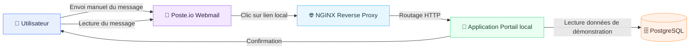

# 🧱 Architecture globale "local only"




## 🔁 Flux applicatif


## 🔐 Accès Mail "Poste.io"

- Identifiant : `noreply@example.com`
- Mot de passe : `***REDACTED***`

- Identifiant : `fxxxxxxx.mxxxxxxxx@cxxx.fr`
- Mot de passe : `***REDACTED***`


## 🔐 Accès GUI BDD

- Identifiant : `alix`
- Mot de passe : `***REDACTED***`


## 🗂️ Arborescence du projet

```
.
├── app
│   ├── app.py
│   ├── Dockerfile
│   ├── requirements.txt
│   ├── static
│   │   ├── app.js
│   │   ├── illustration-login.svg
│   │   ├── rubix-favicon.svg
│   │   └── styles.css
│   └── templates
│       ├── admin_login.html
│       ├── index.html
│       └── results.html
├── db
│   └── init.sql
├── docker-compose.yml
├── email
│   ├── install_notifications.sh
│   ├── notify-mail.service
│   ├── notify-mail.timer
│   ├── notify_new_mail.py
│   ├── security_update_email.html
│   └── send_security_update.py
├── nginx
│   ├── Dockerfile
│   ├── entrypoint.sh
│   ├── site.conf
│   └── ssl
│       ├── portal.example.crt
│       └── portal.example.key
└── README.md
```


### ✉️ Poste.io (webmail) + (NGINX + app + PostgreSQL + menu)

1. Accéder aux interfaces :

| Usage | Lien |
|---|---|
| Webmail | https://mail.local:8443 |
| Webmail - Admin Panel | https://mail.local:8443/admin/login |
| Portail applicatif | https://portal-legacy.example.com |
| Auth Panel - BDD | https://portal-legacy.example.com/admin |
| Identifiants - GUI BDD | https://portal-legacy.example.com/results |


## 🧰 Dépannage rapide

```bash
docker-compose down -v --remove-orphans
```


## 🚀 Démarrage de l'infra

1. Ajouter les hôtes locaux (si nécessaire) :

```bash
sudo sh -c 'printf "127.0.0.1 portal-legacy.example.com\n127.0.0.1 mail.local\n" >> /etc/hosts'
```

2. Démarrer la plateforme :

```bash
docker-compose up -d --build && docker-compose -f docker-compose.yml up -d --build
```
